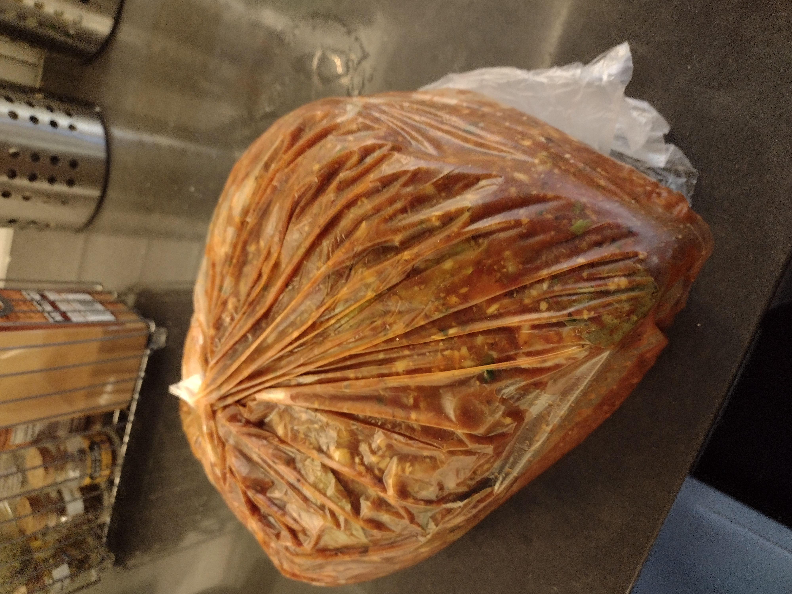
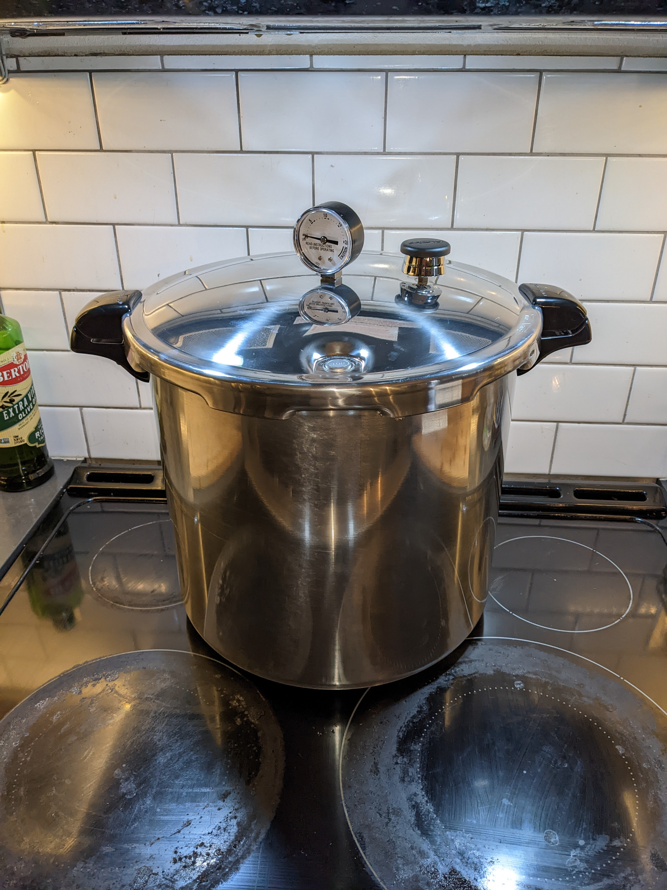

+++
title = "Barbacoa"
date = 2022-05-03
description = "Smoky, juicy Mexican-style pulled pork."

[taxonomies]
categories = ["recipe"]
tags = ["main", "dry", "strong"]
cuisine = ["Mexican"]

[extra]
servings = 16
+++

We affectionately refer to this as "Mexican pulled pork". My take is a little more work than the traditional, but packs in even more smoky goodness.

<!-- more -->

When I volunteered to cook a taco bar lunch for the teaching staff at my wife's school, I decided I needed something a little more authentic. I did a practice barbacoa pork shoulder and was impressed: without sauce, this is way better than traditional pulled pork.

Juicy, a little bit of heat in the back of the mouth, but you can control the heat by not adding too much broth back in.

### Ingredients

- 4.5 kg bone-in pork shoulder (10 lb)

#### Marinade

- 1 can chipotle peppers in adobo
- 1 onion
- 1 head garlic
- 10 whole cloves
- 4 bay leaves
- 500 ml stock
- 200 g Himalayan pink salt
- juice of 3–4 limes
- 3–4 pinches oregano

### Equipment

- Pressure cooker or Instant Pot
- Smoker (optional)

### Prep ahead

Place the pork shoulder in a high-sided casserole, fat cap down. Rub it all over with pink salt and place it in the refrigerator, uncovered, to dry out for 1 week.

Wash off the salt by gently rubbing it all over with a wet hand.

(Optional) Smoke for 4 hours at 225°F with pecan chips. If you don't want to bother, add a few splashes of liquid smoke to the marinade.

Make the marinade by blending the chipotle, adobo, onion, garlic, salt, lime juice and cloves together.

Place the pork in a marinade bag or large bowl, fat cap down. Pour the marinade all over it and add water or more stock to cover, as well as the bay leaves. Tie the marinade bag or cover with a lid; we don't want it to dry out any more. Let it rest in the fridge for 24–48 hours.

### Steps

Move the pork to an Instant Pot or pressure cooker, fat cap up. Pour the marinade over it to cover. Pressure cook for 3 hours (Instant Pot) or 2 hours at 15 lb of pressure in a stovetop pressure cooker.

Remove the meat from the pot and pull it apart, removing the bone, fat and any connective tissue.

Strain the liquid from the pressure cooker. Taste it: if it's super spicy or salty, thin with water to taste, then add {{ q(a="100", b="200", u="ml") }} back to the meat, or until the meat is moist.

### Yield

At about 120 g per person, this yields around 16 servings.
