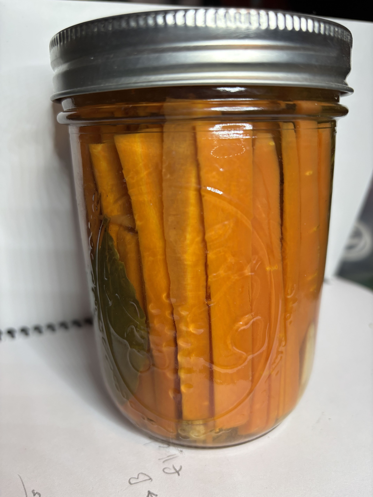

+++
title = "Carrot Pickles"
date = 2026-11-23
description = "Carrot spears pickled with bay leaf and herbs."

[taxonomies]
categories = ["recipe"]
tags = ["side"]
+++

Pickled carrots hold up to home canning better than cucumbers.

<!-- more -->

My personal favorite pickled side.

### Ingredients

- 1 kg carrots
- 500 ml white wine vinegar
- 6–8 bay leaves
- Herbs: rosemary, thyme, dill and sliced ginger
- 1/2–1 clove garlic per jar (optional)
- Handful of black peppercorns (optional)

### Equipment

- Canning pot
- 6 pint jars

### Steps

For presentation, it helps to cut the carrots into matchsticks the same height as the jar (minus headspace). I mark the perfect length on my cutting board with a marker.

For general canning, see my [canning page](@/canning.md).

1. Prep the jars: scald them with boiling water for 30 seconds. If using garlic, place a clove or half clove in the bottom of each jar.
2. Peel the carrots and cut them to jar height.
3. Pack the carrots tightly into each jar. At about the halfway point, place a sprig or bunch of herbs against the glass.
4. Once all of the jars are packed full, fill them 60% full with vinegar.
5. Pour boiling water up to the headspace line. Add a few peppercorns to each jar, if using.
6. Wipe the rims of the jars with a finger and put the lids on, finger tight.
7. Process in a [boiling water bath](@/canning.md) for 10 minutes to seal.

### Yield

5–6 pint jars, depending on the carrots.
