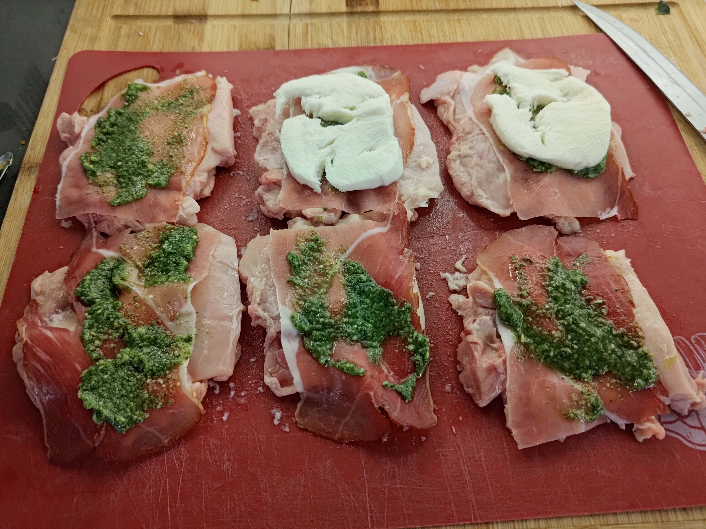

+++
title = "Chicken Involtini"
date = 2023-04-20
description = "Chicken rolled up with prosciutto, mozzarella and pesto."

[taxonomies]
categories = ["recipe"]
tags = ["main", "dry"]
cuisine = ["Italian"]
+++

Mini meat rolls.

<!-- more -->

While there is sauce, it's hidden inside, so it might get a pass as seasoning.

### Ingredients

- chicken breasts or thighs (thighs preferred, although tougher to work with)
- mozzarella
- prosciutto
- bit of pesto

### Steps

#### Thigh prep

Slice the meat so it can be rolled out (see the photo below). Cut the thigh in half after removing the bone, and use the thinner side for something else.

#### Breast prep

For breast meat, putting it in a zip-top or vacuum seal bag and pounding it a bit helps. You can also precook it a bit by using sous vide on the pounded breasts; see the [sous vide guide](@/sousvide.md) for more. You don't want it too thin or it won't hold together.

#### Assemble

Lay out prosciutto, a smear of pesto and a chunk of mozzarella.

Gently roll it up; for thighs you might barely get it to close. Using a wet toothpick or bamboo skewer through the side of the roll might help it hold together better.

#### Bake

Bake in the oven for 30 minutes at 350°F (raw) or 15 minutes at 375°F (sous vide).
