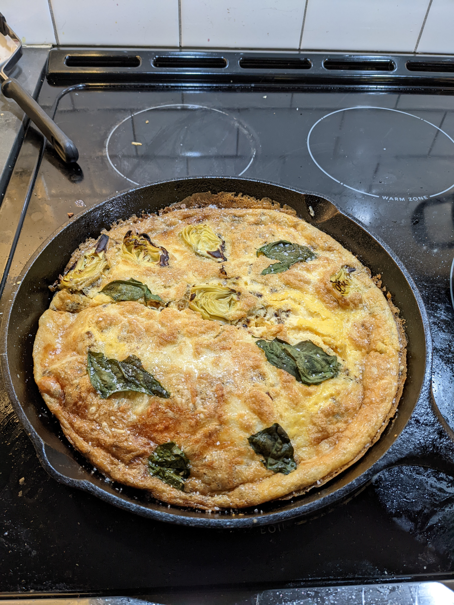

+++
title = "Bacon and Artichoke Frittata"
date = 2022-05-19
description = "Crustless bacon and roasted artichoke frittata."

[taxonomies]
categories = ["recipe"]
tags = ["breakfast", "dry", "crunchy"]
cuisine = ["Italian"]

[extra]
servings = 4
+++

Similar to quiche, but without the crust.

<!-- more -->

### Ingredients

- bacon (optional)
- 1 medium onion
- 10 eggs
- splash of half and half
- Parmesan cheese
- mozzarella cheese
- fresh basil
- 1 can artichoke hearts

### Steps

Set the oven to 400°F to preheat.

Halve some artichoke hearts and place them on a cookie sheet. Place in the oven while it's preheating.

Using a 10 in cast iron pan (for 4 servings), brown/render diced bacon. Scoop out the bacon, leaving the fat in the pan. Sweat the onions and garlic in the rendered bacon fat for a few minutes.

Crack the eggs into a bowl and add the cream while the onions cook. (Optional) Whip with an immersion blender for 1 minute to add some air to the mixture. Turn the heat up almost to the point where the bacon fat smokes.

Once the onions are translucent, gently pour in the egg mixture, trying not to disturb the bacon. Turn the heat off. Add the cheese, carefully spreading it evenly. Remove the artichoke hearts from the oven; they should be starting to darken.

While the residual heat in the pan is cooking the outer edge of the frittata, gently place a few artichoke hearts on top.

Once the outer edge starts to brown, place in the oven for ~12 minutes, or until the egg has set and the top is brown. Test by inserting a knife in the middle; it should come out clean.

### Yield

Serves 4.

### Serving ideas

Any leftover artichoke hearts can be hollowed out, stuffed with cream cheese, bread crumbs and Parmesan, and baked alongside the frittata as a bonus appetizer.
