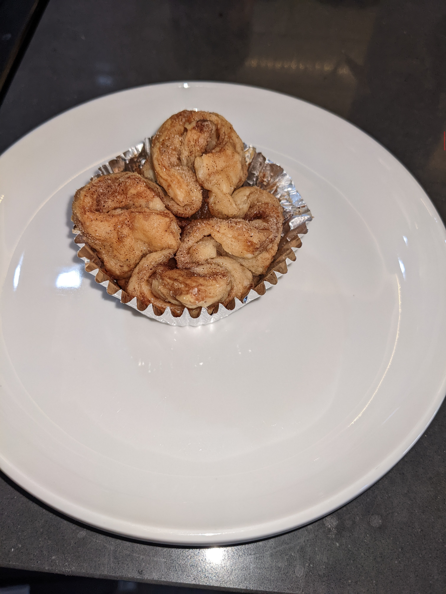
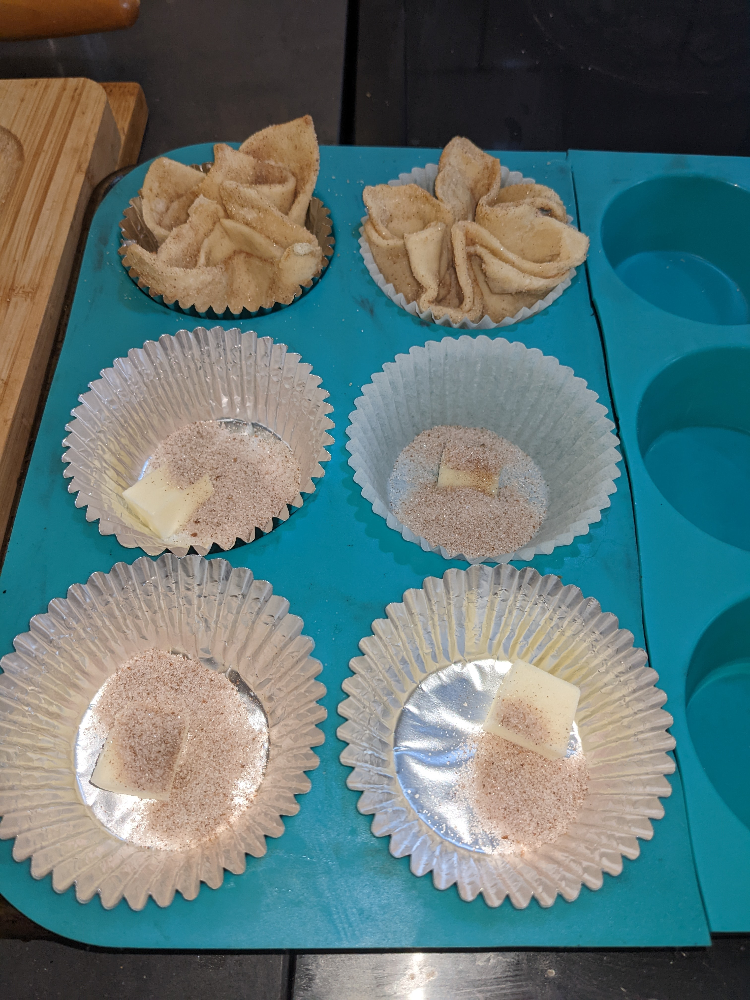
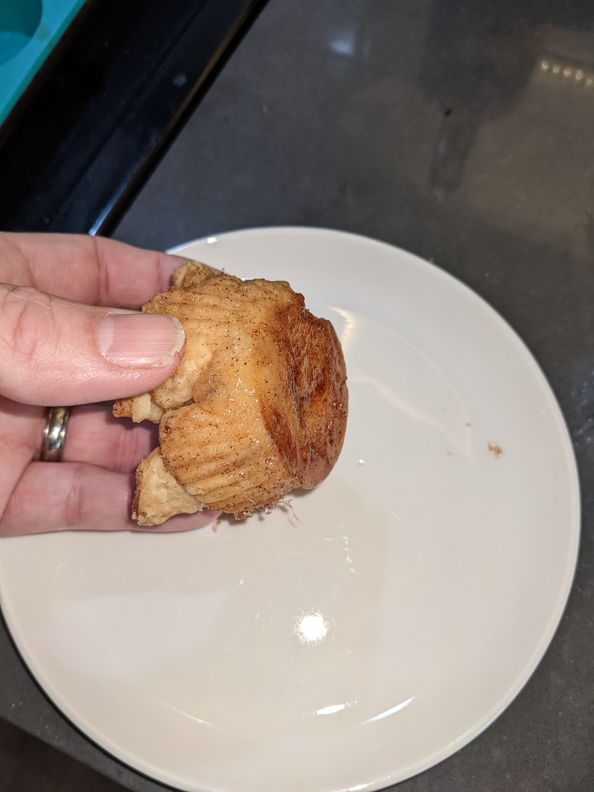

+++
title = "Kouign-Amann"
date = 2022-05-27
description = "Crunchy, caramel-bottomed pastries from puff pastry."

[taxonomies]
categories = ["recipe"]
tags = ["breakfast", "crunchy", "dry"]
cuisine = ["French"]

[extra]
servings = 12
+++

Fancy pastries, with a caramel bottom.

<!-- more -->

There is a bit of technique in getting the shape just right, but it's easier than it looks.

I would like to credit the TV chef that I learned this from, but I'm old and have seen too many.

### Ingredients

- 1 package frozen puff pastry
- 1 stick butter
- 1/2 C white sugar
- 2 T ground cinnamon

### Steps

Preheat the oven to 375°F.

Get a large muffin pan ready, with 12 spots and either paper liners or silicone.

Cut the butter into 1 T "pats", then cut each of those into fourths. We need 24 little tiny cubes total.

Place a tiny cube of butter in the bottom of each muffin cup.

Defrost and lay out the puff pastry on a cutting board. Use a rolling pin to spread it out just a bit. The puff pastry I've been using isn't square, so I cut it into 12 rectangles, 3x4.

Mix the sugar and cinnamon in a small, shallow casserole.

#### Shaping (repeat 12 times)

Take one rectangle of pastry and press it firmly into the sugar/cinnamon mixture. Flip it over and repeat. Slide it aside and do the same with a second rectangle of pastry.

Place one of them over the top of the other, rotated about 45 degrees, so their points don't line up.

Swish them around so a little bit of sugar mixture is on top of the dough, then place a tiny cube of butter in the middle.

Using both hands in a pinching motion, bring the points together and press gently. The goal is to have it look somewhat like a flower.

#### Baking

When you're all done filling the muffin pan, grab a spoon and dust about 1 T of the sugar mixture down into the crevices of the pastry.

Turn the oven down to 325°F and bake for 55 minutes.

If the temperature and time were right, you should be rewarded with a crunchy pastry and a slightly caramelized bottom and inside.

### Yield

12 pastries.
