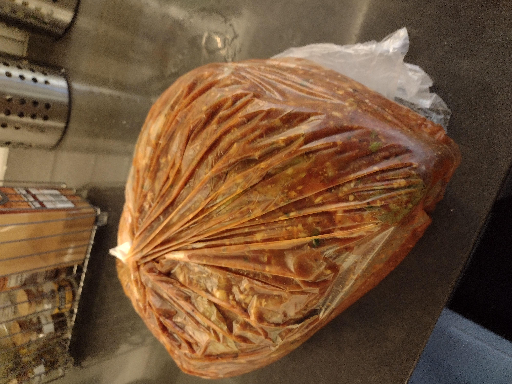

+++
title = "Pulled Pork"
date = 2021-01-01
description = "Cured, smoked pork shoulder, finished in the oven."

[taxonomies]
categories = ["recipe"]
tags = ["main", "dry"]
cuisine = ["American"]
+++

My spin on this, which will offend purists, is to finish off the meat in the oven.

<!-- more -->

We still prefer [barbacoa](@/recipes/barbacoa/index.md) to this recipe.

### Ingredients

- 4.5 kg pork shoulder (10 lb)
- Himalayan pink salt
- soy sauce
- 100 ml apple cider vinegar
- peppercorns
- 3–4 bay leaves
- paprika
- chili powder
- several cloves garlic, crushed

### Equipment

- Smoker

### Prep ahead

Put the shoulder in a high-sided casserole. Rub it all over with pink salt, focusing on the sides without the fat cap.

Place it uncovered in the fridge for 7 days, flipping it over once halfway through. You may want to drain the liquid after 24 hours.

Place it in a large container or marinade bag and add {{ q(a="400", u="ml") }} of an acid (usually apple cider vinegar), {{ q(a="200", u="ml") }} of a salt solution (usually soy sauce), the herbs, and then water to cover. Make sure the meat is completely submerged, and put it back in the fridge for 24–48 hours.

### Steps

Smoke for 4 hours with pecan chips at 250°F. Move to a covered container and add about {{ q(a="100", u="ml") }} of water. Cook in the oven at 325°F for 4 more hours, always covered.

Once done, it will be falling apart. Remove the fat and bone and pull with forks.

### Serving ideas

These make great tacos, sliders and a myriad of other dishes. I generally portion out about 400 g into vacuum seal bags for freezing, and only immediately eat the last bit that doesn't make the 400 g bar.
