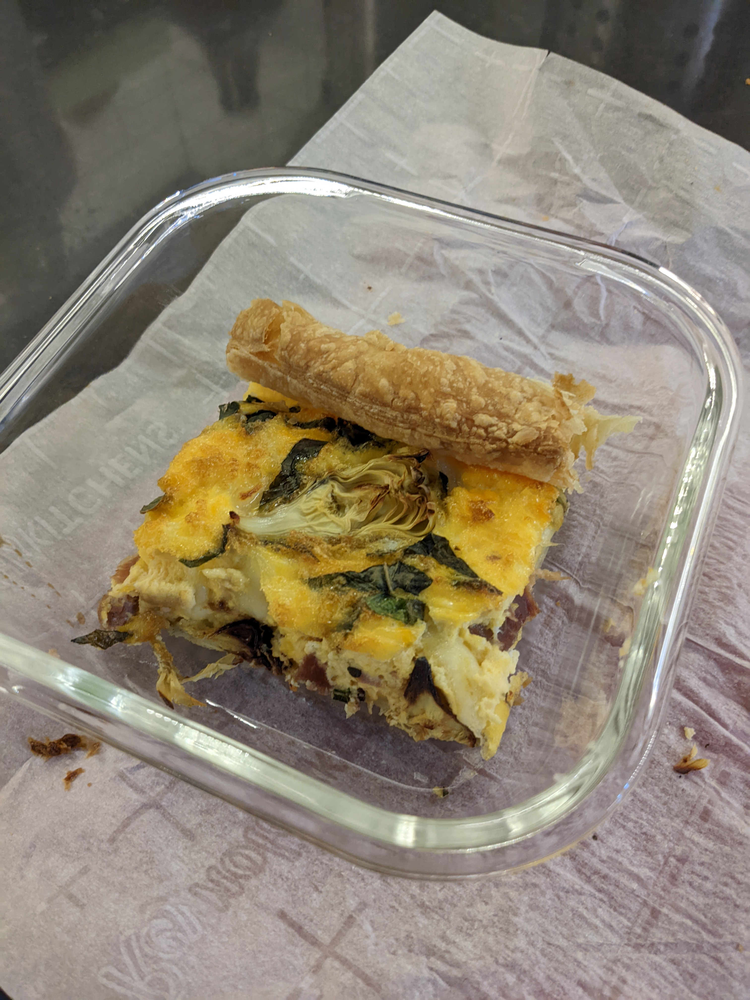

+++
title = "Quiche"
date = 2022-06-10
description = "Artichoke quiche with a crisp puff pastry crust."

[taxonomies]
categories = ["recipe"]
tags = ["main", "breakfast", "crunchy"]
cuisine = ["French"]
+++

A crispy puff pastry crust helps sell this.

<!-- more -->

### Ingredients

- 1 sheet premade puff pastry, defrosted
- 1 can whole artichoke hearts
- cooked bacon bits, prosciutto or cooked mild sausage
- Parmesan cheese
- mozzarella or your favorite cheese blend
- 6–8 eggs
- 1/2 C Greek yogurt
- 3–4 fresh basil leaves

### Steps

1. Preheat the oven to 400°F.
2. Slice the artichoke hearts in half lengthwise and arrange them on a cookie sheet, cut side up. Place in the oven to dry while assembling the quiche.
3. Put down a sheet of parchment paper that's slightly larger than the dish you plan to bake in.
4. Gently roll out the puff pastry on the parchment, stretching it lengthwise to better fit a high-sided casserole dish. I recommend an 11x7 in, but a 9x9 in should also work.
5. Lift the parchment and lay it in the casserole; we're going to bake the quiche _on_ the parchment.
6. (work in progress) Prebake the puff pastry. I'm still not certain how far to take this, but the pastry is coming out a little too squishy. 10 minutes?
7. Make sure the edges of the puff pastry extend up enough to prevent the egg from touching the sides. If they don't go high enough, you'll need to roll it out some more or find a different casserole.
8. Sprinkle your protein of choice, making sure it's cut small enough to be bite-sized.
9. Evenly sprinkle cheese all over the protein.
10. Beat {{ q(a="6", b="8") }} eggs until smooth, then incorporate the Greek yogurt. Gently pour over the cheese, trying not to disturb everything.
11. Chop the basil into thin strips and sprinkle evenly over the top of the quiche.
12. Pull the artichoke hearts out of the oven; they should be starting to char.
13. Place {{ q(a="6", b="8") }} artichoke heart slices on top and bake for 25 minutes, or until it's set. In my convection oven, I had to turn it a few times for even cooking (most ovens still have hot spots).
