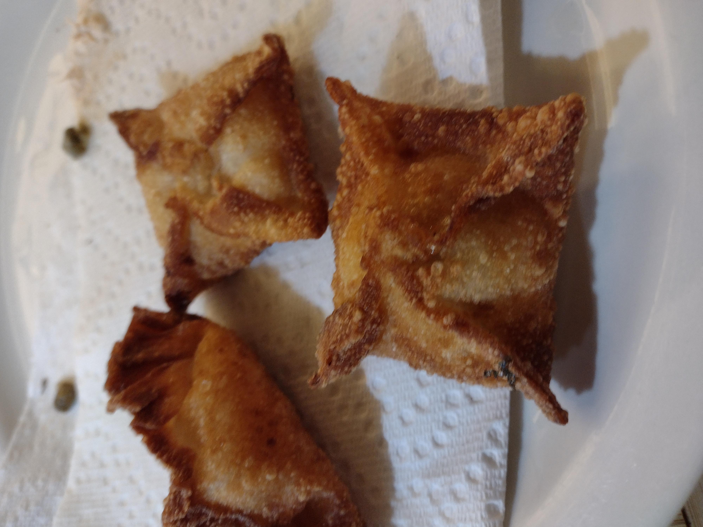

+++
title = "Salmon Rangoon"
date = 2022-05-27
description = "Crispy smoked salmon and cream cheese wontons."

[taxonomies]
categories = ["recipe"]
tags = ["appetizer", "strong", "crunchy"]
cuisine = ["Chinese-American"]
+++

A much more approachable version of a P.F. Chang's appetizer.

<!-- more -->

The salmon can be off-putting to some, hence the "strong" tag.

There are generally two types of smoked salmon: lox (cold-smoked) and regular (hot-smoked). For this recipe, hot-smoked has less moisture and turns out better.

### Ingredients

- spring roll or wonton wrappers
- 1 container cream cheese
- smoked salmon (store-bought or homemade)
- Worcestershire sauce or soy sauce
- neutral cooking oil

### Steps

1. Flake the salmon into a bowl with the cream cheese.
2. Add 2–3 squirts of either Worcestershire or soy. Mix well; there should be no large chunks of salmon.
3. Heat 2–3 inches of oil in a large pan to at least 150°C.
4. Put a spoonful of the cream cheese mixture into each wrapper and, with a wet finger, moisten the outer edge of half of the wrapper. Seal them with a pinch (watch some YouTube videos for various patterns to make it look like you know what you're doing).
5. Fry in the oil at ~175°C, until golden brown and crispy.
6. Rest on a paper towel or drying rack.

### Variations

These could be pan-fried and flipped over halfway through.
