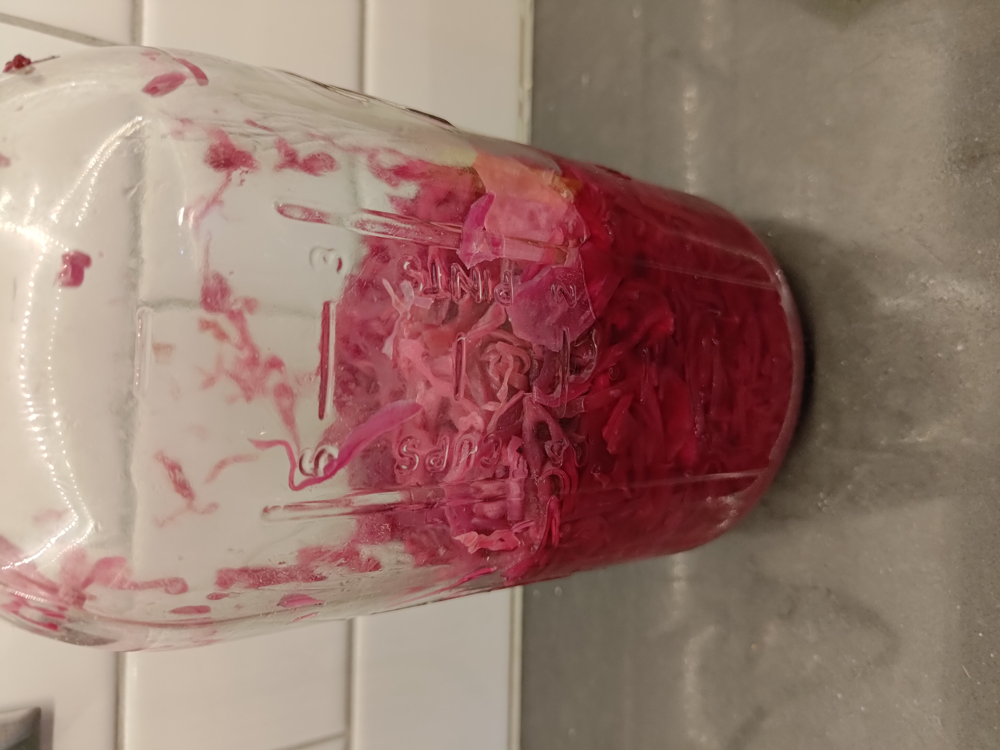

+++
title = "Sauerkraut"
date = 2022-06-23
description = "Simple purple sauerkraut, fermented with 2.5% salt."
aliases = ["/recipes/saurkrat/"]

[taxonomies]
categories = ["recipe"]
tags = ["side", "strong", "acidic"]
cuisine = ["German"]

[extra]
image = "purple.jpg"
+++

Not for everyone.

<!-- more -->

### Ingredients

- 1 head purple cabbage
- 4-5 T dried dill
- ~50–75 g Himalayan pink salt (2.5% of the vegetables' weight; see the steps)

### Equipment

- Large jar with a burp valve lid
- ziplock baggie or kraut stone

### Steps

1. Take an outer leaf of cabbage off and save it as a "lid".
2. Don't wash the cabbage; we're relying on nature for this ferment.
3. Record the weight of a large mixing container
4. Chop the cabbage into thin strips on a mandoline
4. Weigh the chopped cabbage, subtract the weight of the container, then multiply by 2.5%.
5. Use the 2.5% number to weigh out the salt. Add the salt to the mixture and mix with your hands. The cabbage will start to "sweat" after a few minutes of mixing.
6. Leave it for ~1 hour or so to pull out more moisture.
7. Add in the dill, mix
6. Put it in a large jar or crock. The goal is to have it covered with liquid, which in my experience, never happens with store bought cabbage. 
If you need more liquid, mix ~{{ q(a="1", u="C") }} warm water and another pinch of pink salt, to bring the luquid evel up.
7. Cut the outer leaf into a circle to use as a lid and place it on top of the cabbage.
8. Put a Ziploc bag on top and fill it with water, or use a ceramic weight.
9. Put the burp lid on top and set it in a warm spot in the kitchen (I'm not in a warm climate).
10. Let it ferment for 7-10 days, then test it and put it in the refrigerator.

General advice is that it keeps for 6 months.

### Serving ideas

- Reuben sandwiches
- In salads
- With shaved apple and bratwurst

### Credit

Adapted from [*Mouthwatering Sauerkraut*](https://www.amazon.com/dp/0778807339) by Holly Howe. More of my favorite cookbooks are in the [bibliography](@/bibliography.md).
