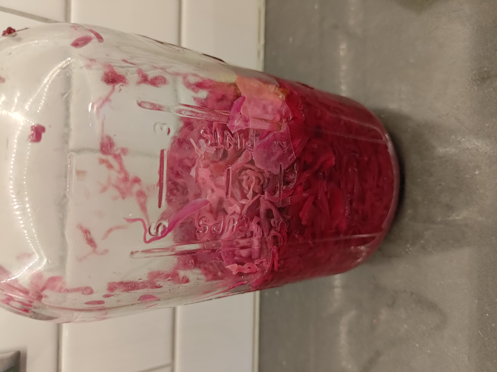

+++
title = "Sauerkraut"
date = 2022-06-23
description = "Simple purple sauerkraut, fermented with 2.5% salt."

[taxonomies]
categories = ["recipe"]
tags = ["side", "strong", "acidic"]
cuisine = ["German"]

[extra]
image = "purple.jpg"
+++

Not for everyone.

<!-- more -->

### Ingredients

- 1 head purple cabbage
- 1 onion
- ~50–75 g Himalayan pink salt (2.5% of the vegetables' weight; see the steps)

### Equipment

- Large jar with a burp valve lid

### Steps

1. Take an outer leaf of cabbage off and save it as a "lid".
2. Don't wash the cabbage; we're relying on nature for this ferment.
3. Chop the onion and cabbage into thin strips. Record the weight of a large mixing container, then put the vegetables in it.
4. Weigh the chopped cabbage and onion, subtract the weight of the container, then multiply by 2.5%.
5. Use the 2.5% number to weigh out the salt. Add the salt to the mixture and mix with your hands. The cabbage will start to "sweat" after a few minutes of mixing.
6. Put it in a large jar and add ~{{ q(a="1", u="C") }} warm water if the cabbage came from the grocery store (not fresh).
7. Cut the outer leaf into a circle to use as a lid and place it on top of the cabbage.
8. Put a Ziploc bag on top and fill it with water as a weight.
9. Put the burp lid on top and set it in a warm spot in the kitchen (I'm not in a warm climate).
10. Let it ferment for ~2 weeks, then test it and put it in the refrigerator.

General advice is that it keeps for 6 months. Mine never lasts that long.

### Serving ideas

- Reuben sandwiches
- In salads
- With shaved apple and bratwurst
